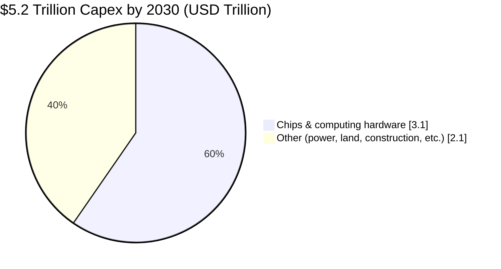

# 🌐 The Global AI Revolution & India's Moment

### *How AI is reshaping the world economy, and why India is emerging as a future growth hub*

[-D32F2F?style=for-the-badge)](https://github.com/rahuldhas-hub/AI-Revolution/blob/66f3c1cd238d7f147e73f75043465e2f33edfb41/The%20Global%20AI%20Revolution%20and%20India.pdf)

---

## 📌 About This Report

An in-depth analysis of the global AI industry and India's rise as an AI powerhouse. It covers market trends, the listed Indian companies investing in AI, and the policy environment. It is written for **fund managers, analysts, and anyone tracking the AI investment theme**.

> 💡 **Want the story behind the numbers?**
> 👉 **[Read the full article on LinkedIn](https://www.linkedin.com/pulse/global-ai-revolution-indias-moment-rahul-dhas-aya4f/)**

---

## 🔥 At a Glance

| 🌍 Global | 🇮🇳 India |
|:---|:---|
| AI market projected at **$4.8T by 2033** (UN) | AI market to **triple to $17B by 2027** (BCG) |
| GenAI to reach **$85B by 2029** (~40% CAGR) | **600,000+** AI professionals (~16% of world talent) |
| **$5.2T** data-center capex needed by 2030 (McKinsey) | **76%** of enterprises report positive AI ROI (IBM) |
| AI could add **$15.7T** to the global economy by 2030 | **₹10,000 Cr** IndiaAI Mission with an 18,000-GPU compute grid |

---

## 🗺️ What's Inside

| # | Section | Highlights |
|:-:|:---|:---|
| 1️⃣ | **The Global AI Industry** | AI's impact on finance, healthcare, manufacturing and more; MLOps, robotics, chips and data centers |
| 2️⃣ | **India's AI Landscape** | Regional-language AI, startups, GCCs, Digital Public Infrastructure, the IndiaAI Mission |
| 3️⃣ | **Listed Indian Companies** | AI investments and strategy of TCS, Infosys, HCLTech, Wipro, Tech Mahindra, LTTS, Tata Elxsi, E2E Networks, Netweb |
| 4️⃣ | **Regulation & Policy** | Facilitators vs. hindrances, the DPDP Act 2023, and the road ahead |
| 5️⃣ | **Investment Outlook** | Opportunities, risks, and strategic recommendations for fund managers |

---

## 📊 Global AI Market Snapshot

| Segment | Size | Horizon | CAGR |
|:---|:---:|:---:|:---:|
| 🤖 Overall AI Market | $4.8 Trillion | 2033 | — |
| ✨ Generative AI | $85 Billion | 2029 | ~40% |
| 🔌 AI Chips | up to $400 Billion | 2027 | — |
| ⚙️ MLOps | $16.61 Billion | 2030 | 40.5% |
| 🦾 Industrial AI Robotics | $36.11 Billion | 2030 | 23.24% |
| 🧩 Robots-as-a-Service | $8.4 Billion | 2032 | 16.7% |

### 💰 Where the $5.2T of AI Data-Center Capex Goes (to 2030)

---

## 🇮🇳 Why India?

- 🧠 **Talent:** 600,000+ AI professionals and a strong STEM base
- 🏗️ **Digital Public Infrastructure:** Aadhaar, UPI, DigiLocker, ONDC
- 📱 **Data:** huge volumes from a very large internet and smartphone base
- 🏛️ **Government push:** IndiaAI Mission (₹10,000 Cr+), 80 AI labs, support for 25+ AI startups
- 🗣️ **Localization:** a 600M+ regional-language internet user opportunity
- 🏢 **GCC hub:** projected 2,400 centers employing 4.5M people by 2030 (EY)

---

## 🏢 Companies Covered

| Company | AI Focus |
|:---|:---|
| **TCS** | Enterprise AI, "perpetually adaptive enterprises" |
| **Infosys** | "AI-first" strategy, Topaz, 400 GenAI projects, 275K employees trained |
| **HCLTech** | Enterprise GenAI and LLMOps (DynaLLMOps) |
| **Wipro** | Industry-specific AI, especially insurance |
| **Tech Mahindra** | GenAI Studio, Agent Launchpad, agentic AI |
| **LTTS** | Industrial AI, digital twins, predictive maintenance |
| **Tata Elxsi** | AI for design and engineering, autonomous systems |
| **E2E Networks / Netweb** | India's AI compute and data-center infrastructure |

---

## ⚖️ Regulation at a Glance

| ✅ Facilitators | ⚠️ Challenges |
|:---|:---|
| IndiaAI Mission compute grid | No dedicated AI law yet |
| Pro-innovation policy stance | Fragmented, sector-wise rules |
| Digital Public Infrastructure | Enforcement and liability gaps |
| DPDP Act 2023 | Legacy-system integration and SME affordability |

---

## 🎯 Key Takeaways for Investors

1. 🧱 **Back the "picks and shovels":** chips, data centers, MLOps
2. 🧭 **Diversify across the AI value chain:** IT services giants plus infrastructure players
3. 🏭 **Look for vertical-specific AI leaders** in healthcare, manufacturing, and BFSI
4. 🔄 **Assess transformation capability,** not just AI adoption rates
5. 📜 **Watch regulatory developments** closely
6. 🌱 **Favor responsible-AI and ESG-ready companies**

---

## 📖 Read More

### 👉 **[Read the Full Article on LinkedIn](https://www.linkedin.com/pulse/global-ai-revolution-indias-moment-rahul-dhas-aya4f/)** 👈

📄 **[Download the Complete PDF Report](https://github.com/rahuldhas-hub/AI-Revolution/blob/66f3c1cd238d7f147e73f75043465e2f33edfb41/The%20Global%20AI%20Revolution%20and%20India.pdf)**

---

## ✍️ Author

**Rahul Dhas**

---

⚠️ **Disclaimer:** This report is for informational and educational purposes only and is not investment advice. Market figures are projections from third-party sources cited in the report and may change.
